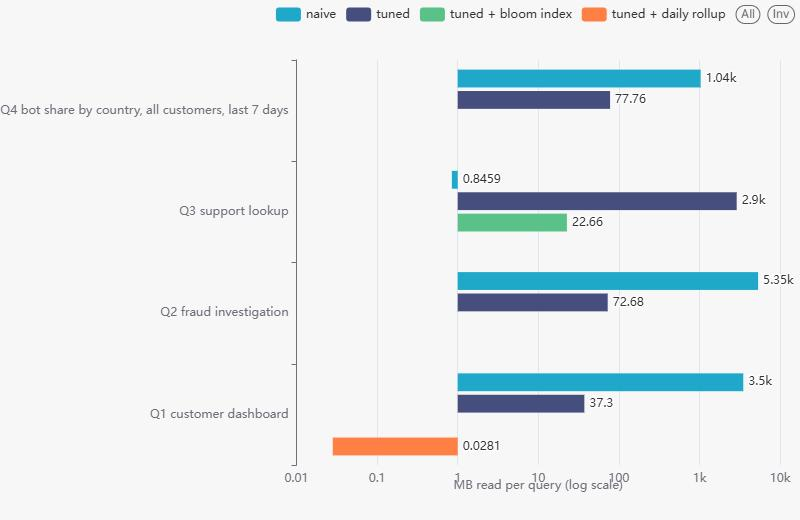

# ClickHouse warehouse guardrails

Device identification events go from Kafka into ClickHouse. dbt models them, Prefect runs each load, and quality gates stop a bad load before it reaches dashboards. The repo also measures which table layout to use and what each choice costs.

I built this as a worked example for the Senior Data Warehouse Engineer role at Fingerprint, using the stack the posting names: ClickHouse, Kafka, dbt, Prefect and Superset. All data is generated sample data shaped like a public identification API's request log. Nothing here uses or describes Fingerprint's internal data or systems.

**Results**

- **Layout:** sorting by customer, day and visitor instead of by request id cuts what ClickHouse reads by **94x** for a customer dashboard query (3.50 GB to 37 MB, 2.9 s to 0.16 s) and **74x** for a fraud investigation query on 100M rows. Storage drops **47%**.
- **Correctness:** **5,600 of 5,600** customer days match an independent answer key exactly. The incremental build equals a full rebuild row for row.
- **Gates:** of **5 injected failures**, 4 were stopped before any dashboard number changed, and 1 (a replayed batch) was absorbed by dedupe with the marts identical to the row.



```
docker compose up -d
python -m venv .venv
.venv\Scripts\activate          # macOS/Linux: source .venv/bin/activate
pip install -r requirements.txt
python run_all.py               # pipeline proof, then the 100M row benchmark (slow: loading 100M rows twice)
python run_all.py --skip-bench  # pipeline proof only, a few minutes
pytest
```

Every number in this README comes from [`reports/results.md`](reports/results.md), which `run_all.py` writes.

## The problem

An identification API writes one event per call. At that volume the warehouse has two jobs that pull against each other.

1. **Speed vs cost.** Customer dashboards, fraud investigations and support lookups each want a different physical layout. With the wrong sort key, ClickHouse reads the whole table to answer a question about one customer.
2. **Quality and consistency.** Kafka delivers at least once. SDKs buffer events offline and send them days late. A bad SDK release can stop returning visitor ids. A device clock can be a year off. A malformed message can stall a consumer. Each of these quietly changes a dashboard number unless something stops it.

## What was built

```
generator (sample events) -> Redpanda topic (Kafka API)
  -> ClickHouse Kafka engine -> materialized view -> raw.identification_events  (every delivery, Kafka offset kept)
                             -> materialized view -> raw.dead_letter             (messages that failed to parse)
  -> dbt
       stg_identification_events             incremental, insert_overwrite by event day, deduped on request_id
       stg_identification_events_quarantine  null visitor id or future timestamp, kept with the reason
       mart_customer_daily                   requests, unique visitors, bot/VPN/incognito per customer per day
       mart_bot_traffic_daily                bad bot and VPN share per country per day
  -> Prefect flow per load: send -> wait until every message landed -> source freshness -> dbt build
```

Design choices worth reading:

- **Late events by rebuilding whole days.** Each run finds every event day touched by newly landed rows and rebuilds those days from raw, then swaps them in with `REPLACE PARTITION`. A late event from four days ago lands in the right day, and a replayed batch produces exactly the same day again. Proof: incremental build vs from-scratch build, 0 differing rows on all four tables.
- **Quarantine rows, gate rates.** A single null visitor id or bad clock is normal. It goes to quarantine with a reason, and the load continues. A *rate* above threshold for this load (null visitor ids above 2% for any SDK version on any day, future timestamps above 1%) fails the build.
- **Failed gates do not publish.** `dbt build` runs staging's tests before anything downstream, so when a gate fails, the marts keep yesterday's numbers instead of showing a fake traffic drop. One gotcha: dbt only lets a test block downstream models if everything the test reads is upstream of them, so staging declares the dead letter table as an input (see `stg_identification_events.sql`). Without that line, the dead letter gate failed and the marts published anyway. The first run of this repo caught exactly that.
- **A bad message does not stall the consumer.** The Kafka engine runs with `kafka_handle_error_mode = 'stream'`, so unparseable messages go to `raw.dead_letter` with the parser error, and a gate fails the load.
- **Every message accounted for.** Before dbt runs, Prefect waits until raw rows plus dead letter rows equal messages sent, with retries. A stalled consumer fails the load there.

## Injected failures

`run_all.py` breaks the stream five ways, one load at a time, after the clean 14 days:

| Failure | What happened | Marts (what dashboards read) |
|---|---|---|
| Consumer group reset: yesterday's 128k messages delivered again | Absorbed: staging dedupes on request_id and rebuilds the same days | Identical |
| SDK release fails to identify 25% of its visitors | Blocked by `gate_null_visitor_rate` | Unchanged, not published |
| Client clock skew: 3% of events stamped a year ahead | Blocked by `gate_future_event_rate` | Unchanged, not published |
| Poison message: a word where a number belongs | Dead lettered, consumer kept going, blocked by `gate_dead_letter` | Unchanged, not published |
| Consumer stalled (materialized views detached) | Blocked before dbt: 0 of 40,600 messages landed after retries | Unchanged |

After the stall, the views were reattached. The consumer resumed from its committed offset, all 40,600 messages landed, the build passed and the day published. The baseline before the failures: 1,705,193 messages over 14 days, a 10 day backfill and 4 daily loads, with 25,193 duplicate deliveries, 31,121 late events, 5,112 null visitor ids and 806 future timestamps. Staging holds exactly the 1,674,082 valid requests, and quarantine holds exactly the 5,918 planted problems.

## Layout benchmark

100,000,000 sample rows across 90 days and 400 customers with skewed traffic. ClickHouse 24.8, local Docker. Median of 5 runs after a warm up. Every layout returned the same answer as naive.

| Layout | How it is built |
|---|---|
| naive | String columns, Nullable visitor id, `ORDER BY request_id` (the row store habit of sorting by the unique id), no partitioning |
| tuned | LowCardinality, IPv4, Bool and Float32 types, Delta+ZSTD on time, `PARTITION BY day`, `ORDER BY (subscription_id, day, visitor_id, event_time)` |

| Query | naive | tuned | Data read, naive to tuned |
|---|---:|---:|---:|
| Q1 customer dashboard: one customer, 30 days, requests and unique visitors per day | 2,885 ms | **155 ms** | 3.50 GB to 37 MB |
| Q2 fraud investigation: every request from one visitor of one customer | 3,929 ms | **187 ms** | 5.35 GB to 73 MB |
| Q3 support lookup: one request by request_id | **8 ms** | 2,159 ms | 0.8 MB to 2.90 GB |
| Q4 bot share by country, all customers, last 7 days | 539 ms | **132 ms** | 1.04 GB to 78 MB |

| Storage | Compressed |
|---|---:|
| naive table | 7.42 GB |
| tuned table | **3.90 GB** |

Then two optional structures on top of tuned, each measured for what it buys and what it costs:

| Addition | Buys | Costs | Verdict |
|---|---|---|---|
| Bloom filter skip index on `request_id` | Q3 from 2,159 ms to **57 ms** (reads 23 MB instead of 2.9 GB) | 126 MB, 3% of the table | Keep: it fixes the one query the tuned sort key makes worse |
| Daily rollup per customer (AggregatingMergeTree via materialized view) | Nothing measurable: Q1 took 219 ms vs 155 ms from the tuned table | 298 MB | Skip for now. Once the sort key is right, the raw table answers this fast enough. Revisit if dashboard query volume grows |

## Assumptions

- The event shape follows a public identification API response (visitor id, request id, confidence, bot result, incognito, VPN, linked id). Field names, volumes and rates are my assumptions, not Fingerprint's.
- `subscription_id` stands for the customer account a request is made under. I assume most warehouse questions are scoped to one customer and a date range.
- Customer traffic is skewed (a few customers send most requests), which is what makes the sort key matter.

## Repo layout

| Path | What it is |
|---|---|
| `docker-compose.yml` | Redpanda, ClickHouse 24.8, optional Superset (`--profile bi`) |
| `warehouse/raw.sql` | Kafka engine table, raw table, dead letter table, materialized views |
| `generator/events.py` | Seeded sample stream and its answer key |
| `pipeline/flow.py` | The Prefect flow |
| `dbt/` | Models, gates (`dbt/tests/gate_*.sql`) and checks |
| `bench/benchmark.py` | Naive vs tuned layout measurement |
| `run_all.py` | All of the above, end to end, exiting non-zero on any miss |
| `superset/bootstrap.py` | Loads benchmark results into ClickHouse and builds the Superset chart above |
| `tests/` | pytest: generator logic, plus checks against the built warehouse |
| `reports/` | `results.md`, `results.json`, `benchmark.json` from the last run |
